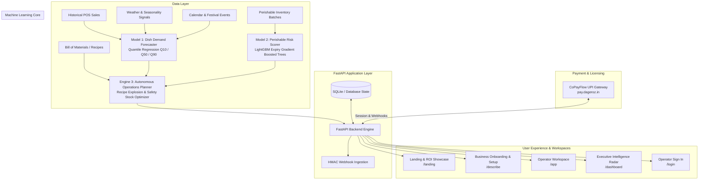

<p align="center">
  
</p>

<h1 align="center">OatEasy AI — Autonomous Restaurant & Kitchen Intelligence OS</h1>

<p align="center">
  <strong>Machine Learning Demand Forecasting · Perishable Waste Prevention · Automated Chef Prep Sheets · 1-Click Supplier Purchasing</strong>
</p>

<p align="center">
  
  
  
  
  
</p>

---

## 📌 What is OatEasy AI?

**OatEasy AI** is an end-to-end operational intelligence and demand-planning operating system built for commercial food businesses — including **Dine-In Restaurants, Cloud Kitchens, Hotels & Buffets, and Hostels/Institutional Messes**.

### 🛑 The Problem It Solves
Commercial kitchens operate on razor-thin margins (typically 8–15%) while losing **4% to 10% of total revenue directly to food waste and stockouts**:
- **Over-Preparation**: Chefs prep large batches based on gut feeling. If evening footfall drops due to rain or weekday slumps, expensive prepped proteins and sauces spoil and are thrown into the bin.
- **Stockouts & 86'd Dishes**: Under-prepping popular dishes leads to angry customers, canceled food delivery orders, and lost revenue during peak rush hours.
- **Manual, Fragmented Planning**: Head chefs and kitchen managers waste 2 to 3 hours every morning calculating prep quantities by hand and compiling chaotic supplier purchase orders over WhatsApp and spreadsheets.
- **Hidden Inventory Expiry**: Walk-in chillers hold dozens of perishable ingredient batches with invisible expiry countdowns, leading to routine spoilage write-offs.

### 💡 The Solution
OatEasy AI connects live historical sales data, weather indicators, weekday trends, and calendar events into **production machine learning pipelines**:
1. It **predicts exact dish-level demand** across 7 days using Quantile Regression (p10, p50, p90).
2. It **scores every batch of perishable inventory** with Gradient Boosted Decision Trees to spot spoilage risk before it occurs.
3. It **translates demand into morning station-by-station chef prep workorders**.
4. It **automatically drafts supplier purchase orders** with dynamic safety-stock buffers and delivery lead-time compensation.

---

## 🏗️ System Architecture



---

## 🌟 Comprehensive Feature Summary

### 1. 🧠 Quantile Dish Demand Forecasting (Model 1)
- **7-Day Rolling Horizon**: Generates daily and hourly demand predictions for every menu item.
- **Multi-Quantile Forecasting**:
  - **Q50 (Median)**: Expected demand baseline for standard prep.
  - **Q10 (Lower Bound / Rainy Day Mode)**: Minimum buffer to prevent over-prepping during slow weather or post-holiday lulls.
  - **Q90 (Peak Surge Mode)**: High-traffic upper ceiling for weekend evenings, festivals, and major sports broadcasts.
- **Context Signals**: Incorporates weather temperatures, precipitation levels, day-of-week patterns, holidays, and promotional boosts.

### 2. 🛡️ Perishable Inventory Risk Radar (Model 2)
- **Dynamic Risk Score (0–100%)**: Evaluates ingredient batches against consumption velocity and time-to-expiry.
- **Storage Condition Tracking**: Visual badges and compliance telemetry for:
  - ❄️ **Walk-in Chillers** (1°C to 4°C)
  - 🧊 **Deep Freezers** (-18°C)
  - 🌾 **Dry Ambient Storage** (18°C to 22°C)
- **Risk Tiers**:
  - 🟢 **Low Risk**: Adequate shelf-life, consumption matches on-hand stock.
  - 🟡 **Medium Risk**: Consumption velocity lagging shelf-life; monitor closely.
  - 🔴 **High / Critical Risk**: Batch will expire within 24–48 hours unless prepped or promoted today.

### 3. 🍳 Automated Morning Chef Prep Sheets
- **Station-by-Station Layout**: Groups prep actions by station:
  - 🥗 *Pantry & Cold Larder*
  - 🥘 *Curry, Sauce & Gravy Base*
  - 🥩 *Butchery & Protein Marinades*
  - 🥖 *Bakery, Breads & Dough*
  - 🍳 *Hot Line, Grill & Fry*
- **Actionable Quantities**: Translates dish demand into raw batch prep requirements (e.g., *Prep 14.5 kg Makhani Gravy Base by 11:30 AM*).
- **Interactive Checklist**: Kitchen staff can mark batches as `In Progress`, `Completed`, or `Deferred` with timestamped records.

### 4. 📦 1-Click Supplier Purchasing & Restock Optimizer
- **Bill of Materials (BOM) Explosion**: Automatically calculates required raw materials for the forecasted menu covers.
- **Lead-Time & Safety Stock Buffering**: Prevents stockouts by adjusting order timing according to supplier delivery lead times (e.g., 24h dairy vs 48h dry goods).
- **Supplier PO Drafts**: Pre-formats supplier orders with unit costs, order minimums, SKU codes, and batch allocations ready for dispatch.

### 5. 📊 Executive Operations Radar & Telemetry Dashboard (`/dashboard`)
- **C-Suite & Multi-Unit Visibility**: High-altitude margin protection view for restaurant owners, franchise operators, and executive chefs.
- **Key Real-Time Metrics**:
  - 💰 *Waste Avoidance Value (₹ Saved)*
  - 📉 *Target Waste Percentage vs Realized Waste*
  - 🎯 *Forecast Accuracy & Mean Absolute Percentage Error (MAPE)*
  - ⚡ *Active Stockout Risk Count*
- **Hourly Traffic Distribution**: Visual bar charts and heatmap projections for kitchen rush-hour readiness.

### 6. 🏪 Multi-Concept Operating Models (`/describe`)
OatEasy AI dynamically reconfigures its algorithms, safety buffers, and prep frequencies based on the business type:
| Concept Model | Operational Profile | Algorithm Behavior |
| :--- | :--- | :--- |
| **Restaurant & Dine-In** | High weekend variance, table covers, multi-course dishes | Prioritizes line station prep and Friday–Sunday Q90 surge readiness |
| **Cloud Kitchen / Delivery** | Rapid 15-minute fulfillment, aggregator order rushes, batch proteins | Maximizes pre-portioned marinades and high-velocity dispatch buffers |
| **Hotel & Buffet Dining** | High volume, continuous pan replenishment, banquet surges | Emphasizes bulk base prep and breakfast/dinner rush scheduling |
| **Hostel & Mess Operations** | Fixed meal schedules (Breakfast/Lunch/Dinner), strict headcount | Fixed head-count forecasting with zero-waste portion optimization |

### 7. 💳 CoPayFlow Integrated UPI Payment Gateway
- **Production-Ready Licensing**: Built-in integration with CoPayFlow (`pay.dageroz.in` or local tunnel).
- **Instant QR Checkout**: Dynamic modal displaying live UPI QR codes, instant UPI app triggers (GPay, PhonePe, Paytm, BHIM), and direct VPA copying.
- **Cryptographic Security**: Server-to-server HMAC-SHA256 signature verification on `/api/webhook` to activate tenant subscriptions safely.
- **Flexible Plans**: Starter Kitchen (₹3,999/mo), Pro Kitchen (₹8,999/mo), and Enterprise Hub (₹21,999/mo).

### 8. 🔐 Operator Authentication & Role Controls (`/login`)
- **Role-Based Views**:
  - 👨‍🍳 *Head Chef*: Prep sheets, station queues, recipe adjustments.
  - 📋 *Operations Manager*: Purchase orders, waste analytics, stock logs.
  - 👔 *Store General Manager*: Full dashboard, telemetry, staff performance.
  - 🚚 *Purchasing Officer*: Vendor catalogs, unit pricing, receiving checks.
- **Instant Demo Evaluation**: Pre-seeded demo credentials for instant evaluation with realistic operational datasets.

---

## 📂 Project Directory Structure

```
FreshFlowAI/
├── .env                                  # Local production secrets (ignored by Git)
├── .env.example                          # Environment variable template
├── .gitignore                            # Comprehensive ignore rules (.env, models, logs)
├── requirements.txt                      # Python application dependencies
├── README.md                             # Project documentation
│
├── backend/                              # FastAPI Application Core
│   ├── main.py                           # Application entry point, static routes & webhooks
│   ├── freshflow.db                      # SQLite operational database
│   ├── api/routes/                       # REST API route controllers
│   │   ├── actions.py                    # Action approval, deferral & completion routes
│   │   ├── analytics.py                  # Historical demand & waste analysis endpoints
│   │   ├── forecasts.py                  # ML demand forecast endpoints
│   │   ├── inventory.py                  # Stock level & perishable risk endpoints
│   │   ├── reports.py                    # Summary telemetry & executive reports
│   │   └── restaurants.py                # Multi-unit outlet management endpoints
│   ├── db/                               # Database schemas & persistence
│   │   ├── database.py                   # SQLite connection provider
│   │   └── seed_data.py                  # Seed engine for dishes, inventory & restaurants
│   ├── ml/                               # Machine Learning inference runtime
│   │   ├── features.py                   # Feature transformation & engineering pipelines
│   │   └── model_loader.py               # Joblib loader for trained models
│   └── services/                         # Business & planning logic
│       ├── demand_service.py             # Demand forecasting orchestration
│       ├── planning_service.py           # Prep and purchasing optimization engine
│       ├── report_service.py             # Telemetry compilation
│       └── risk_service.py               # Expiry risk classification logic
│
├── FreshFlow_ML/                         # ML Training, Notebooks & Datasets
│   ├── data/                             # Master catalogs (dishes, ingredients, recipes, calendar)
│   ├── models/                           # Serialized Joblib models (Poisson, Q10, Q90, GBM)
│   ├── notebooks/                        # Jupyter notebooks for model development & evaluation
│   └── outputs/                          # Generated forecast CSVs & operational metrics
│
└── static/                               # Modern UI Assets (Vanilla HTML/CSS/JS)
    ├── app.html                          # Operations Workspace (Multi-Tab Interface)
    ├── app.js                            # Interactive client application controller
    ├── dashboard.html                    # Executive Intelligence Telemetry Dashboard
    ├── describe.html                     # Business Profiling & Subscription Checkout
    ├── index.html                        # Gateway redirect & initial splash loader
    ├── landing.html                      # Marketing landing page & interactive walkthrough
    ├── login.html                        # Operator login screen with demo profiles
    ├── logo.png                          # Official OatEasy AI brand mark
    ├── oateasy-icon.png                  # Crisp square sunburst emblem
    ├── favicon.ico / favicon.png         # Multi-resolution browser favicons
    ├── styles.css                        # Design system & tactile styling
    └── youpi.js                          # CoPayFlow Universal Payment Gateway SDK
```

---

## ⚡ Quickstart & Running Locally

### 1. Prerequisites
- Python 3.10, 3.11, or 3.12
- Node.js 18+ (if running the local CoPayFlow payment gateway)
- Modern Web Browser (Chrome, Edge, Safari, Firefox)

### 2. Setup Virtual Environment & Install Dependencies
```bash
# Clone the repository and navigate into the project
cd FreshFlowAI

# Create virtual environment
python -m venv venv

# Activate virtual environment
# On Windows PowerShell:
.\venv\Scripts\Activate.ps1
# On macOS / Linux:
source venv/bin/activate

# Install required dependencies
pip install -r requirements.txt
```

### 3. Configure Environment Variables
Copy `.env.example` to `.env`:
```bash
cp .env.example .env
```
Key configuration parameters in `.env`:
```env
PORT=8000
ENVIRONMENT=development

# CoPayFlow Payment Gateway (Production Domain or Localhost)
YOUPI_GATEWAY_URL=https://pay.dageroz.in
YOUPI_INTERNAL_GATEWAY_URL=http://127.0.0.1:7000
YOUPI_MERCHANT_KEY=00000000-0000-0000-0000-000000000001
YOUPI_WEBHOOK_SECRET=merchant_webhook_secret_for_wallet_store
YOUPI_CURRENCY=INR
```

### 4. Start the Application
```bash
python -m uvicorn backend.main:app --host 0.0.0.0 --port 8000 --reload
```

### 5. Access the Platform
| Workspace | URL | Description |
| :--- | :--- | :--- |
| 🌐 **Landing Page** | [http://localhost:8000](http://localhost:8000) | Public product showcase & feature walkthrough |
| 🏪 **Onboarding & Plans** | [http://localhost:8000/describe](http://localhost:8000/describe) | Business model selector & UPI payment activation |
| 🍳 **Operations App** | [http://localhost:8000/app](http://localhost:8000/app) | Chef prep workorders, inventory radar & purchasing |
| 📊 **Executive Dashboard** | [http://localhost:8000/dashboard](http://localhost:8000/dashboard) | High-level margin protection and waste analytics |
| 🔑 **Operator Sign In** | [http://localhost:8000/login](http://localhost:8000/login) | Role-based sign-in with instant demo credentials |
| 📖 **Interactive API Docs** | [http://localhost:8000/docs](http://localhost:8000/docs) | Swagger UI for all backend REST endpoints |

---

## 📡 REST API Reference

OatEasy AI provides a comprehensive RESTful API for integration with POS systems, ERPs, and inventory scanners:

### 🥗 Inventory & Perishable Risks
- `GET /api/v1/inventory?restaurant_id={id}`: Returns live ingredient stock levels, batch dates, and shelf-life status.
- `GET /api/v1/inventory/risks?restaurant_id={id}`: Returns ML-scored perishable waste risk levels per ingredient batch.

### 📈 Demand Forecasts
- `GET /api/v1/forecasts?restaurant_id={id}`: Returns 7-day quantile dish demand predictions (Q10, Q50, Q90).
- `GET /api/v1/analytics/historical-demand?restaurant_id={id}`: Historical sales velocity and covers telemetry.

### 📋 Operational Workplans & Actions
- `GET /api/v1/plans/prep?restaurant_id={id}`: Station-by-station morning chef prep schedule.
- `GET /api/v1/plans/purchases?restaurant_id={id}`: Optimized supplier purchase order proposals.
- `GET /api/v1/actions?restaurant_id={id}&status=pending`: Action queue requiring human chef/manager verification.
- `POST /api/v1/actions/{action_id}/complete`: Marks an action as completed with timestamped audit logging.
- `POST /api/v1/actions/{action_id}/defer`: Defers an action to a later shift.

### 💳 Payments & Webhooks
- `GET /api/v1/payments/config`: Fetches active gateway URLs and client configuration.
- `POST /api/v1/payments/create-session`: Proxies creation of a real CoPayFlow UPI payment session.
- `POST /api/webhook`: Ingests and cryptographically validates HMAC-SHA256 payment confirmations.

---

## 🔐 Security & Privacy Architecture

- **No Shared Proprietary Recipes**: All demand models and recipe explosions are isolated per tenant database.
- **HMAC-SHA256 Cryptographic Webhooks**: Payment and telemetry integrations are cryptographically signed to prevent injection or replay attacks.
- **Zero-Storage for Sensitive UPI Credentials**: Payment processing is completely decoupled; no bank details or UPI MPINs ever touch OatEasy AI servers.
- **Local / Self-Hosted Compatibility**: OatEasy AI can be deployed fully air-gapped on on-premise local servers or local kitchen tablets without external cloud dependency.

---

## 📄 License & Attribution

Distributed under the **MIT License**.  
Developed and maintained with **OatEasy AI Intelligence**.
